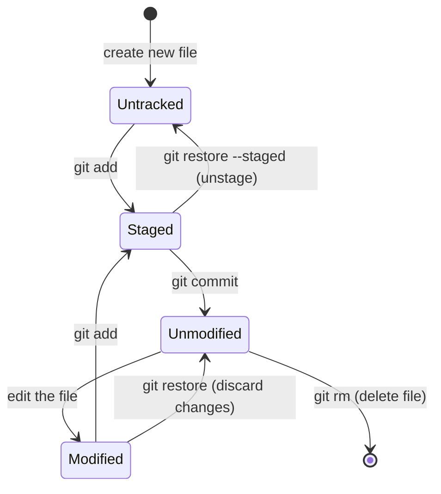
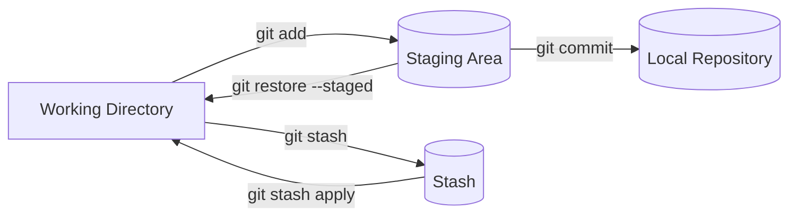
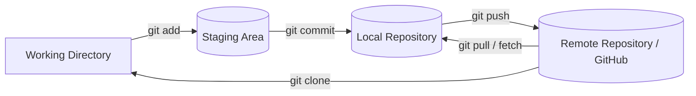
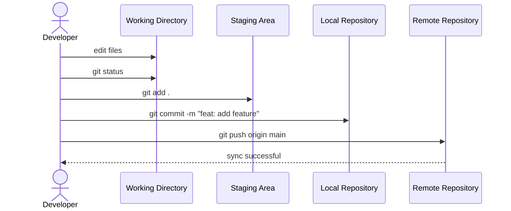

# Git Cheat Sheet

A practical Git cheat sheet covering the complete file lifecycle, local workflow, remote (GitHub) integration, and common commands — with pure [Mermaid](https://mermaid.js.org/) diagrams rendered natively by GitHub.

---

## Table of Contents

- [Diagrams](#diagrams)
  - [Diagram 1 — File Lifecycle / States](#diagram-1--file-lifecycle--states)
  - [Diagram 2 — Local Workflow](#diagram-2--local-workflow)
  - [Diagram 3 — Complete Data Flow (Local & Remote)](#diagram-3--complete-data-flow-local-remote)
  - [Diagram 4 — Git Command Flow in a Work Cycle](#diagram-4--git-command-flow-in-a-work-cycle)
- [Commands](#commands)
  - [Window & Help](#window--help)
  - [Configuration](#configuration)
  - [Initializing a Repository](#initializing-a-repository)
  - [Tracking Files & File Lifecycle](#tracking-files--file-lifecycle)
  - [Staging Logic](#staging-logic)
  - [Commits & History](#commits--history)
  - [Branching & Merging](#branching--merging)
  - [Undoing Changes](#undoing-changes)
  - [Gitignore](#gitignore)
  - [Stash](#stash)
  - [Remote Repository Setup (GitHub)](#remote-repository-setup-github)
  - [Remote Commands](#remote-commands)
- [Quick Reference Summary](#quick-reference-summary)

---


## Diagrams

### Diagram 1 — File Lifecycle / States

How a file moves between Git's main states.


### Diagram 2 — Local Workflow

The three local areas of a Git repository, plus Stash.



### Diagram 3 — Complete Data Flow (Local & Remote)

Data flow between local areas and GitHub (Remote).



### Diagram 4 — Git Command Flow in a Work Cycle

A typical sequence of Git actions in one development day.



---

## Commands

### Window & Help

```bash
clear    # clear the terminal window
git      # show all git commands / help
```

### Configuration

```bash
git config user.name "Name"             # set name for the current project only
git config --global user.name "Name"    # set name for the whole system (global)
git config user.email "Email"           # set email for the current project only
git config --global user.email "Email"  # set email for the whole system (global)
git config --list                       # show all configuration settings
```

### Initializing a Repository

```bash
cd path                 # navigate to your project directory
git init                # initialize a new git repository in the project directory
```

### Tracking Files & File Lifecycle

```bash
touch filename.ext      # create a new empty file
git status              # show the state of files in the working directory
```

### Staging Logic

After a change in the directory, `git add` moves the changes to the **staging area**, and `git commit` sends them to the **repository**.

```bash
git add <filenames>               # stage specific changes
git add a.txt b.txt               # example: stage two files
git add .                         # stage all files
git restore --staged a.txt        # unstage a file (restore from staging)
```

### Commits & History

```bash
git commit -m "arbitrary message for remember"   # commit staged changes
git log                                          # view commit history
git log --oneline                                # one-line log — first line after HEAD is the last commit
git log --stat                                   # log with more details per commit
```

### Branching & Merging

```bash
git branch                                    # list local branches
git branch <branchname>                       # create a new branch
git switch <branchname>                       # switch to a branch (modern command)
git switch -c <branchname>                    # create and switch in one step (modern)
git checkout <branchname>                     # switch to a branch (classic command)
git checkout -b <branchname>                  # create and switch in one step (classic)
git merge <branchname>                        # merge a branch into the active branch
git branch -m <oldname> <newname>             # rename a branch
git branch -d <branchname>                    # delete a branch safely (after merge)
git branch -D <branchname>                    # delete a branch forcefully
```

### Undoing Changes

```bash
git checkout <hashcommit>                   # go to a specific commit (review old code)
git checkout main                           # return to the latest state afterwards
git branch <newbranchname> <hashcommit>     # branch from a previous commit
git revert <hashcommit>                     # undo the effect of a commit (best for the last commit)
git reset <hashcommit> --soft               # remove commits, keep changes staged
git reset <hashcommit> --mixed              # remove commits, unstage (untracked) files
git reset <hashcommit> --hard               # remove commits AND all changes
```

### Gitignore

```bash
touch .gitignore               # 1. create the .gitignore file
git add .                      # 2. stage it
git commit -m "add gitignore"  # 3. commit it
# then add files or paths to ignore inside .gitignore

touch README.md                # create a README and write information in Markdown
```

### Stash

```bash
git stash                             # save changes without committing
git stash list                        # view all stashes
git stash apply <id in stashlist>     # apply a stash from the list
git stash clear                       # clear all stashes
git stash save "message"              # save a stash with an explanatory message
```

### Remote Repository Setup (GitHub)

1. **First**, create a repository on GitHub.
2. **Second**, generate an SSH key and add it to GitHub:

```bash
ssh-keygen                     # generate an SSH key pair
# then add the public key (~/.ssh/id_rsa.pub) to GitHub → Settings → SSH and GPG keys
```

### Remote Commands

```bash
git push <remote repository address>                     # push the local repository to the remote
git push <remote repository address> <branchname>        # push a branch to the remote repository
git remote add <nameforrepo> <remote repository address> # assign a short name to a remote repository
git push <reponame> <branchname>                         # push using the remote name (repeat for each branch)
```

### Working with Other Repositories

```bash
fork                                     # copy someone else's repository on GitHub
git clone <remote repository address>    # clone a remote repository locally
```

> **Tip:** it is better to make changes for other repositories in a separate branch.

---

## Quick Reference Summary

| Task | Command |
|---|---|
| Clear terminal / show git help | `clear` / `git` |
| Set user name / email (current project) | `git config user.name "Name"` / `git config user.email "Email"` |
| Set user name / email (global) | `git config --global user.name "Name"` / `git config --global user.email "Email"` |
| List configuration | `git config --list` |
| Navigate to project / initialize repo | `cd path` / `git init` |
| Create a new file | `touch filename.ext` |
| Check file status | `git status` |
| Stage changes (specific / all) | `git add <filenames>` / `git add .` |
| Unstage a file | `git restore --staged a.txt` |
| Commit changes | `git commit -m "message"` |
| View history | `git log`, `git log --oneline`, `git log --stat` |
| List / create branches | `git branch` / `git branch <branchname>` |
| Switch branch (modern) | `git switch <branchname>` / `git switch -c <branchname>` |
| Switch branch (classic) | `git checkout <branchname>` / `git checkout -b <branchname>` |

| Merge branch into main | `git merge <branchname>` |
| Rename / delete branch | `git branch -m old new` / `git branch -d <branch>` / `git branch -D <branch>` |
| Go to a commit / return | `git checkout <hashcommit>` / `git checkout main` |
| Undo a commit | `git revert <hashcommit>` |
| Reset (soft / mixed / hard) | `git reset <hash> --soft` / `--mixed` / `--hard` |
| Ignore files | `touch .gitignore`, `git add .`, `git commit -m "add gitignore"` |
| Save / view / apply / clear stash | `git stash` / `git stash list` / `git stash apply <id>` / `git stash clear` |
| Stash with message | `git stash save "message"` |
| Generate SSH key for GitHub | `ssh-keygen` |
| Push to remote (address) | `git push <remote address>` / `git push <remote address> <branchname>` |
| Name a remote | `git remote add <nameforrepo> <address>` |
| Push with remote name | `git push <reponame> <branchname>` |
| Copy / clone a repo | `fork` / `git clone <remote address>` |
